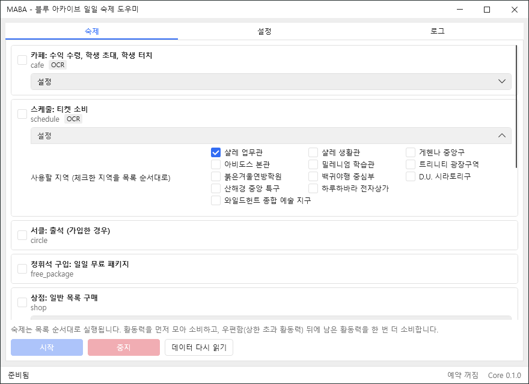

[한국어](README.md) | **English**

<div align="center">

# MABA

### Maba Assistant Blue Archive

Screen-recognition automation that works through the daily routine,  
from the cafe to the daily missions, in a fixed order

<br/>

[](https://www.microsoft.com/windows)
[](https://isocpp.org/)
[](https://dotnet.microsoft.com/)
[](https://www.python.org/)
[](docs/ROADMAP.md)
[](LICENSE)

<br/>

[**Download**](../../releases/latest)
&nbsp;·&nbsp;
[Documentation](docs/ARCHITECTURE.md)
&nbsp;·&nbsp;
[Contributing](CONTRIBUTING.md)

<br/>



</div>

---

## ✦ Overview

MABA is a Windows assistant that handles the repetitive daily tasks of Blue Archive.

It captures the game screen, recognizes the current state with image matching and OCR, and then performs each step with ordinary mouse input (ADB touch on emulators).

It never accesses game files, process memory or network packets. Only screen capture and ordinary input are used.

## ✦ Features

### 01. Collect

- Claim cafe income
- Invite and tap students
- Run schedules
- Circle attendance
- Claim the daily free package

### 02. Spend

- Shop bulk purchase
- Bounty
- Commission sweeps (Base Defense, Item Retrieval)
- Scrimmage
- Event story and quests
- Campaign mission sweeps
- Tactical challenge: claim rewards and use tickets

### 03. Complete

- Claim mailbox rewards (including AP above the cap)
- Claim daily mission rewards
- Record resources per account

### Additional Features

| Feature | Description |
|:---|:---|
| Scheduled Execution | Scheduled runs after the server reset or at a set time each day |
| Game Launch | Starts the game (Steam or emulator) when it is off, closes it afterwards (optional) |
| Popup Handling | Login notices, attendance, reward and battle result popups, handled by one global handler |
| Battle Automation | Keeps AUTO and 3x speed on in battles |
| Story Skip | Stories are only skipped, never read |
| Task Configuration | Enable each task and set its details |
| Account Tracking | Nickname, level, credits, pyroxene and AP per account, shown on the My info tab (stored on this PC only) |
| Display Language | Program UI in Korean and English (**Display language** in the settings; defaults to the Windows language) |
| Template Override | Custom screen-recognition templates |

## ✦ Architecture

```text
MabaAssistantBlueArchive/
│
├── gui/                # C# WPF Desktop Application
│   └── Maba.Gui
│
├── core/               # C++20 Automation Engine
│   ├── include/maba    # Public Headers & C API
│   ├── src             # Controller, Vision, Navigator, Task Engine
│   │   └── platform/windows   # Screen Capture & Input (Windows only)
│   ├── apps            # Command-line Tool (maba_cli)
│   └── tests           # Unit Tests
│
├── ocr/                # Python OCR Sidecar
├── tools/              # Template Capture & Check Tools
│
├── tasks/              # JSON Task Definitions
├── pages/              # Page Recognition Definitions
├── popups/             # Popup Recognition Definitions
├── assets/             # Recognition Templates
├── config/             # Language Configuration
├── strings/            # In-game Text Keys for Recognition
└── docs/               # Project Documentation
```

### Task-driven Architecture

The order and the steps of each task are declared in JSON files.

`order` sets the run order; `after` is used only where a failed task must block the next one.

Adding a task or changing the order needs no change to the engine code.

## ✦ Installation

### 1. Download

Download the latest archive from [GitHub Releases](../../releases/latest).

### 2. Extract

Unpack the archive into any folder.

### 3. Run

Run `MabaAssistantBlueArchive.exe`.

> **Runtime Notice**
>
> The release package includes the .NET runtime, the Python runtime, the OCR models and the screen-recognition templates, so nothing else needs to be installed.
>
> Settings are stored in `%APPDATA%\MabaAssistantBlueArchive`.

### Before Running

- Run the game in 16:9 windowed mode.
- Leave the mouse alone while MABA is running. If another window covers the game, MABA stops instead of clicking.
- Run the game and MABA with the same privilege level. If only the game runs as administrator, Windows blocks the input.
- Set up teams 1-4 for quests in advance.
- To start the game automatically, use **Launch** in the settings. The Steam version is started through Steam; for an emulator, enter its executable and arguments. Scheduled runs use them too.
- Enter the names of students to invite exactly as the game shows them. Example (Korean client): `아루, 히나(수영복)`

### Template Customization

The default screen-recognition templates are based on the Korean client.

If recognition fails because of a different screen layout or UI, capture the templates again with the [template capture tool](tools/README.md).

Custom templates go in `assets-local/` and take precedence over the default templates.

When capturing, mask your nickname, UID, friend list and mail contents.

## ✦ Build from Source

### Requirements

- Windows 10 / 11
- Visual Studio 2022
- CMake
- vcpkg
- .NET 10 SDK
- Python 3.12

The Windows build needs the `VCPKG_ROOT` environment variable.

### Build Core

```bash
cmake --preset windows-msvc

cmake --build --preset windows-msvc

ctest --preset windows-msvc
```

### Build GUI

```bash
dotnet build gui/Maba.Gui -c Release
```

### Set up OCR

```bash
python -m venv ocr/.venv

ocr/.venv/Scripts/python -m pip install -r ocr/requirements.txt
```

Core looks for Python in `ocr/.venv`, then the `ocr/python/` runtime bundled with a release, then `python` on PATH. See the [OCR documentation](ocr/README.md) for details.

### Linux Development

On Linux, the `linux-dev` preset builds and tests the platform-independent Core logic.

```bash
cmake --preset linux-dev

cmake --build --preset linux-dev

ctest --preset linux-dev --output-on-failure
```

Required packages: `cmake g++ nlohmann-json3-dev`. For the Vision tests, add `libopencv-dev` and use the `linux-opencv` preset.

## ✦ Open Source Libraries

MABA uses several open-source projects for screen recognition, OCR, JSON data handling and the user interface.

The copyright and license of each library follow that project's terms.

| Library | Version | Purpose | License |
|:---|:---|:---|:---|
| [OpenCV](https://github.com/opencv/opencv) | 4.12.0 | Image processing and screen recognition | Apache-2.0 |
| [RapidOCR](https://github.com/RapidAI/RapidOCR) | 3.10.0 | OCR text recognition | Apache-2.0 |
| [ONNX Runtime](https://github.com/microsoft/onnxruntime) | 1.31.1 | OCR model inference runtime | MIT |
| [PaddleOCR](https://github.com/PaddlePaddle/PaddleOCR) models | as fetched by RapidOCR 3.10.0 | Text detection and recognition models | Apache-2.0 |
| [JSON for Modern C++](https://github.com/nlohmann/json) | 3.12.0 | C++ JSON parsing and serialization | MIT |
| [HandyControls](https://github.com/HandyOrg/HandyControl) | 3.7.0 | WPF UI controls | MIT |
| [CommunityToolkit.Mvvm](https://github.com/CommunityToolkit/dotnet) | 8.4.2 | C# MVVM support | MIT |
| [Pillow](https://github.com/python-pillow/Pillow) | 12.3.0 | Template capture tool | MIT-CMU |
| [zlib](https://zlib.net/) | as built by vcpkg | OpenCV dependency | Zlib |
| [libpng](http://www.libpng.org/pub/png/libpng.html) | as built by vcpkg | OpenCV dependency | libpng-2.0 |
| [libjpeg-turbo](https://libjpeg-turbo.org/) | as built by vcpkg | OpenCV dependency | IJG AND BSD-3-Clause AND Zlib |
| [.NET Runtime](https://github.com/dotnet/runtime) | 10.0 | Runs the GUI (included in releases) | MIT |
| [Python](https://www.python.org/) | 3.12.10 | Runs OCR (included in releases) | PSF-2.0 |
| MaaTouch | supplied by the user | Emulator touch (optional, not included) | Apache-2.0 |


### Third-party Notices

- The copyright of each library belongs to its authors and the rights holders of that project.
- The full license texts and copyright notices of each library are in [THIRD_PARTY_NOTICES.md](THIRD_PARTY_NOTICES.md).
- The OCR models (PaddleOCR) are Apache-2.0; the runtimes, libraries and Python packages included in releases are also listed with their notices in `THIRD_PARTY_NOTICES.md`.
- This software is based in part on the work of the Independent JPEG Group.

## ✦ Documentation

| Document | Description |
|:---|:---|
| [Architecture](docs/ARCHITECTURE.md) | System architecture |
| [Task Format](docs/PAGE_FORMAT.md) | Page, popup and task JSON format |
| [Roadmap](docs/ROADMAP.md) | Development roadmap |
| [Decisions](docs/DECISIONS.md) | Technical design decisions |
| [Tools](tools/README.md) | Template capture and check tools |
| [OCR](ocr/README.md) | OCR sidecar setup and languages |
| [Contributing](CONTRIBUTING.md) | Development and contribution guide |
| [Third-party Notices](THIRD_PARTY_NOTICES.md) | Open-source licenses and copyright notices |

## ✦ Contributing

MABA is an open-source project.

Bug reports, improvements and development contributions are welcome.

Please read [CONTRIBUTING.md](CONTRIBUTING.md) before contributing. It covers the commit format and the privacy check.

## ✦ License & Disclaimer

This project is licensed under the **AGPL-3.0-only** license.

Blue Archive and its related assets are the property of NEXON Korea Corp. and NEXON GAMES Co., Ltd. and are not covered by this project's license.

- MABA is an independent, unofficial fan-made project.
- The MABA name and the original artwork of its logo and icons are © 2026 ChoHye0N, the developer, and are not covered by this project's license.
- Third-party libraries and their assets are subject to their respective licenses.
- MABA uses image recognition and ordinary input only; it never reads or modifies game memory, files or network traffic.
- Using automation software may violate the game's Terms of Service. Users are solely responsible for any consequences, including account restrictions.

See [LICENSE](LICENSE) and [THIRD_PARTY_NOTICES.md](THIRD_PARTY_NOTICES.md) for details.

---

<div align="center">

[Back to Top](#maba)

</div>
