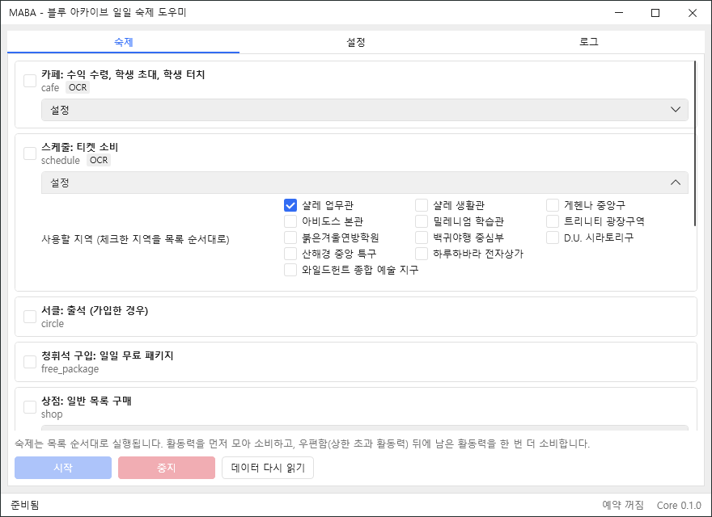

**한국어** | [English](README.en.md)

<div align="center">


# MABA

### Maba Assistant Blue Archive

화면 인식 기반 자동화로 카페부터 일일 미션까지  
매일 반복되는 게임 내 작업을 정해진 순서대로 처리합니다

<br/>

[](https://www.microsoft.com/windows)
[](https://isocpp.org/)
[](../../releases/latest)
[](LICENSE)
[](../../releases)

<br/>

[**Download**](../../releases/latest)
&nbsp;·&nbsp;
[Documentation](docs/ARCHITECTURE.md)
&nbsp;·&nbsp;
[Contributing](CONTRIBUTING.md)

<br/>



</div>

---

## ✦ Overview

MABA는 블루 아카이브의 반복적인 일일 숙제를 자동으로 처리하는 Windows 기반 도우미입니다.

게임 화면을 캡처하고 이미지 매칭과 OCR을 통해 현재 상태를 인식한 다음, 일반적인 마우스 입력(에뮬레이터는 ADB 터치)으로 작업을 수행합니다.

게임 파일, 프로세스 메모리, 네트워크 패킷에는 접근하지 않습니다. 화면 캡처와 일반 입력만 사용합니다.

릴리스 버전은 시작할 때 GitHub에서 새 버전이 있는지 확인합니다. 프로그램 새 버전은 알림만 띄우고, 리소스(숙제 데이터, 화면 정의, 템플릿)는 새 것이 있으면 내려받아 바로 적용합니다(체크섬과 내용 검사를 통과한 경우에만). 게임이나 계정 정보는 보내지 않으며, 설정에서 끌 수 있습니다.

## ✦ Features

### 01. Collect — 자원 수집

- 카페 수익 수령
- 학생 초대 및 터치
- 스케줄 실행
- 서클 출석
- 통합 출석부 캠페인 출석 보상 수령
- 일일 무료 패키지 수령
- 제조 완료 수령 및 빠른 제조

### 02. Spend — 자원 소비

- 상점 일괄 구매
- 현상수배
- 특별의뢰 소탕 (거점 방어, 물건 회수)
- 학원교류회
- 이벤트 스토리 및 퀘스트
- 임무 소탕 및 일괄 소탕 (노말, 하드 프리셋)
- 전술 대회 보상 수령 및 도전권 사용

### 03. Complete — 일일 정리

- 우편함 보상 수령 (상한을 넘는 활동력 포함)
- 일일 미션 보상 수령
- 배틀패스 미션 포인트와 레벨 보상 수령 (시즌 중에만)
- 계정별 재화 기록

### Additional Features

| Feature | Description |
|:---|:---|
| Scheduled Execution | 서버 초기화 후 또는 매일 지정한 시각에 예약 실행 |
| Game Launch | 게임(Steam 또는 에뮬레이터)이 꺼져 있으면 켜고, 끝나면 종료 (선택) |
| Popup Handling | 로그인 공지, 출석, 보상, 전투 결과 팝업을 하나의 전역 처리기로 처리 |
| Battle Automation | 전투 중 AUTO 및 3배속 유지 |
| Story Skip | 스토리는 읽지 않고 건너뛰기만 수행 |
| Task Configuration | 작업별 활성화 및 세부 설정 |
| Account Tracking | 계정별 닉네임, 레벨, 크레딧, 청휘석, 활동력 기록, GUI의 내 정보 탭에서 확인 (PC에만 저장) |
| Task Profiles | 숙제 선택, 설정, 실행 순서를 프로필로 저장하고 전환 |
| AP Purchase | 청휘석으로 AP 구매, 1회 가격 상한과 횟수 지정 (기본 꺼짐, 선택했을 때만 실행) |
| Display Language | 프로그램 화면 한국어, 영어 지원 (설정의 **화면 언어**, 기본값은 Windows 언어) |
| Template Override | 사용자 정의 화면 인식 템플릿 지원 |

## ✦ Architecture

```text
MabaAssistantBlueArchive/
│
├── gui/                # C# WPF Desktop Application
│   └── Maba.Gui
│
├── core/               # C++20 Automation Engine
│   ├── include/maba    # Public Headers & C API
│   ├── src             # Controller, Vision, Navigator, Task Engine
│   │   └── platform/windows   # Screen Capture & Input (Windows only)
│   ├── apps            # Command-line Tool (maba_cli)
│   └── tests           # Unit Tests
│
├── ocr/                # Python OCR Sidecar
├── tools/              # Template, Check & Live-check Tools
│
├── tasks/              # JSON Task Definitions
├── pages/              # Page Recognition Definitions
├── popups/             # Popup Recognition Definitions
├── assets/             # Recognition Templates
├── config/             # Language Configuration
├── strings/            # In-game Text Keys for Recognition
└── docs/               # Project Documentation
```

### Task-driven Architecture

작업의 순서와 세부 동작은 JSON 파일에 선언적으로 정의됩니다.

`order`로 실행 순서를 정하고, 앞 작업이 실패했을 때 다음 작업을 막아야 하는 경우에만 `after`를 사용합니다.

새로운 작업을 추가하거나 기존 작업의 순서를 변경할 때 엔진 코드를 고치지 않아도 됩니다.

## ✦ Installation

### 1. Download

[GitHub Releases](../../releases/latest)에서 최신 배포 파일을 다운로드합니다.

### 2. Extract

다운로드한 압축 파일을 원하는 폴더에 압축 해제합니다.

| 위치 | 내용 |
|---|---|
| `MabaAssistantBlueArchive.exe` | 프로그램 |
| `bin/` | 코어 라이브러리, 명령줄 도구 |
| `data/` | 숙제, 화면 정의, 템플릿, 템플릿 도구 |
| `ocr/` | OCR용 Python과 모델 |

### 3. Run

`MabaAssistantBlueArchive.exe`를 실행합니다.

> **Runtime Notice**
>
> 릴리스 패키지에는 .NET 런타임, Python 런타임, OCR 모델, 화면 인식 템플릿이 모두 포함되어 있어 따로 설치할 것이 없습니다.
>
> 설정(숙제 선택, 숙제 설정, 순서, 프로필)과 계정 기록은 `%APPDATA%\MabaAssistantBlueArchive` 폴더에 저장됩니다. 새 버전은 새 폴더에 압축을 풀면 되며, 설정은 그대로 이어집니다.

### Before Running

- 게임을 16:9, 1280x720 이상의 창으로 실행합니다. 맞지 않으면 실행할 때 1280x720으로 바꿉니다(설정에서 끌 수 있음).
- MABA 실행 중에는 마우스를 직접 조작하지 않는 것을 권장합니다. 다른 창이 게임을 가리면 클릭하지 않고 멈춥니다.
- 게임과 MABA를 동일한 권한 수준으로 실행합니다. 게임만 관리자 권한으로 실행하면 Windows가 입력을 막습니다.
- 퀘스트에 사용할 부대 1~4번을 미리 편성합니다.
- 숙제 탭에서 실행할 숙제를 체크합니다. 숙제를 누르면 오른쪽에 설명과 설정이 나오고, 손잡이를 끌어 순서를 바꿀 수 있습니다.
- 게임을 메인 화면에 둔 채 시작하는 것을 권장합니다.
- 게임을 자동으로 켜려면 설정의 **실행 준비**를 사용합니다. Steam판은 Steam으로 게임을 켜고, 에뮬레이터는 실행 파일과 인자를 입력합니다. 예약 실행도 이 설정을 따릅니다.
- 초대할 학생의 이름은 게임에 표시되는 이름과 동일하게 입력합니다. 예: `아루, 히나(수영복)`

### Template Customization

기본 화면 인식 템플릿은 한국어 클라이언트 기준입니다.

화면 구성이나 UI 차이로 인해 인식이 실패한다면 [템플릿 캡처 도구](tools/README.md)를 이용해 다시 캡처할 수 있습니다.

사용자 정의 템플릿은 `assets-local/`(릴리스는 `data/assets-local/`)에 저장하며 기본 템플릿보다 우선 적용됩니다.

캡처할 때는 닉네임, UID, 친구 목록, 우편 내용이 보이지 않도록 마스크로 가려 주세요.

## ✦ Build from Source

### Requirements

- Windows 10 / 11
- Visual Studio 2022
- CMake
- vcpkg
- .NET 10 SDK
- Python 3.12

Windows 빌드에는 `VCPKG_ROOT` 환경 변수가 설정되어 있어야 합니다.

### Build Core

```bash
cmake --preset windows-msvc

cmake --build --preset windows-msvc

ctest --preset windows-msvc
```

### Build GUI

```bash
dotnet build gui/Maba.Gui -c Release
```

### Set up OCR

```bash
python -m venv ocr/.venv

ocr/.venv/Scripts/python -m pip install -r ocr/requirements.txt
```

Core는 `ocr/.venv`, 릴리스에 포함된 `ocr/python/`, PATH의 `python` 순서로 Python을 찾습니다. 자세한 내용은 [OCR 문서](ocr/README.md)를 참고해 주세요.

### Linux Development

Linux에서는 `linux-dev` 프리셋을 이용해 플랫폼 독립적인 Core 로직을 빌드하고 테스트할 수 있습니다.

```bash
cmake --preset linux-dev

cmake --build --preset linux-dev

ctest --preset linux-dev --output-on-failure
```

필요한 패키지는 `cmake g++ nlohmann-json3-dev`이며, Vision 테스트에는 `libopencv-dev`와 `linux-opencv` 프리셋을 사용합니다.

## ✦ Open Source Libraries

MABA는 안정적인 화면 인식, OCR 처리, JSON 데이터 관리 및 사용자 인터페이스 구현을 위해 여러 오픈소스 프로젝트를 활용합니다.

각 라이브러리의 저작권과 라이선스는 해당 프로젝트의 정책을 따릅니다.

| Library | Version | Purpose | License |
|:---|:---|:---|:---|
| [OpenCV](https://github.com/opencv/opencv) | 4.12.0 | 이미지 처리 및 화면 인식 | Apache-2.0 |
| [RapidOCR](https://github.com/RapidAI/RapidOCR) | 3.10.0 | OCR 텍스트 인식 | Apache-2.0 |
| [ONNX Runtime](https://github.com/microsoft/onnxruntime) | 1.31.1 | OCR 모델 추론 런타임 | MIT |
| [PaddleOCR](https://github.com/PaddlePaddle/PaddleOCR) 모델 | RapidOCR 3.10.0 기준 | 글자 검출 및 인식 모델 | Apache-2.0 |
| [JSON for Modern C++](https://github.com/nlohmann/json) | 3.12.0 | C++ JSON 파싱 및 직렬화 | MIT |
| [HandyControls](https://github.com/HandyOrg/HandyControl) | 3.7.0 | WPF UI 컨트롤 | MIT |
| [CommunityToolkit.Mvvm](https://github.com/CommunityToolkit/dotnet) | 8.4.2 | C# MVVM 구현 지원 | MIT |
| [Pillow](https://github.com/python-pillow/Pillow) | 12.3.0 | 템플릿 캡처 도구 | MIT-CMU |
| [zlib](https://zlib.net/) | vcpkg 빌드 | OpenCV 의존성 | Zlib |
| [libpng](http://www.libpng.org/pub/png/libpng.html) | vcpkg 빌드 | OpenCV 의존성 | libpng-2.0 |
| [libjpeg-turbo](https://libjpeg-turbo.org/) | vcpkg 빌드 | OpenCV 의존성 | IJG AND BSD-3-Clause AND Zlib |
| [.NET Runtime](https://github.com/dotnet/runtime) | 10.0 | GUI 실행 (릴리스에 포함) | MIT |
| [Python](https://www.python.org/) | 3.12.10 | OCR 실행 (릴리스에 포함) | PSF-2.0 |
| MaaTouch | 사용자가 준비 | 에뮬레이터 터치 (선택, 포함하지 않음) | Apache-2.0 |


### Third-party Notices

- 각 라이브러리의 저작권은 원저작자 및 해당 프로젝트의 권리자에게 있습니다.
- 라이브러리별 라이선스 전문과 저작권 고지는 [THIRD_PARTY_NOTICES.md](THIRD_PARTY_NOTICES.md)에서 확인할 수 있습니다.
- OCR 모델(PaddleOCR)은 Apache-2.0이며, 릴리스에 포함된 런타임, 라이브러리, Python 패키지 목록과 고지도 `THIRD_PARTY_NOTICES.md`에 정리되어 있습니다.
- This software is based in part on the work of the Independent JPEG Group.

## ✦ Documentation

| Document | Description |
|:---|:---|
| [Architecture](docs/ARCHITECTURE.md) | 시스템 아키텍처 |
| [Task Format](docs/PAGE_FORMAT.md) | 페이지, 팝업 및 작업 JSON 형식 |
| [Roadmap](docs/ROADMAP.md) | 개발 로드맵 |
| [Decisions](docs/DECISIONS.md) | 기술적 설계 결정 |
| [Tools](tools/README.md) | 템플릿 캡처, 점검, 실제 게임 확인 도구 |
| [OCR](ocr/README.md) | OCR 사이드카 설정 및 언어 |
| [Contributing](CONTRIBUTING.md) | 개발 및 기여 가이드 |
| [Third-party Notices](THIRD_PARTY_NOTICES.md) | 오픈소스 라이선스 및 저작권 고지 |

## ✦ Contributing

MABA는 오픈소스 프로젝트입니다.

버그 제보, 기능 개선 및 개발 기여를 환영합니다.

기여하기 전에 [CONTRIBUTING.md](CONTRIBUTING.md)를 확인해 주세요. 커밋 형식과 개인정보 검사 방법이 정리되어 있습니다.

## ✦ License & Disclaimer

이 프로젝트는 **AGPL-3.0-only** 라이선스를 따릅니다.

블루 아카이브 및 관련 리소스의 권리는 NEXON Korea Corp. 및 NEXON GAMES Co., Ltd.에 있으며, 이 프로젝트의 라이선스에 포함되지 않습니다.

- MABA는 비공식 개인 팬 프로젝트입니다.
- MABA의 이름과 로고 및 아이콘의 창작 부분에 대한 권리는 개발자인 ChoHye0N에 있으며, 이 프로젝트의 라이선스에 포함되지 않습니다. 로고에 그려진 캐릭터(치도리 미치루)의 원작 권리는 NEXON Korea Corp. 및 NEXON GAMES Co., Ltd.에 있습니다.
- 서드파티 라이브러리와 그 리소스는 각각의 라이선스를 따릅니다.
- MABA는 화면 인식과 일반 입력만 사용하며, 게임 메모리, 파일, 네트워크 통신을 읽거나 변경하지 않습니다.
- 자동화 프로그램 사용은 게임 이용약관에 위반될 수 있으며, 계정 제재를 포함한 모든 결과의 책임은 사용자에게 있습니다.

자세한 내용은 [LICENSE](LICENSE) 및 [THIRD_PARTY_NOTICES.md](THIRD_PARTY_NOTICES.md)를 참고해 주세요.

---

<div align="center">

[Back to Top](#maba)

</div>
